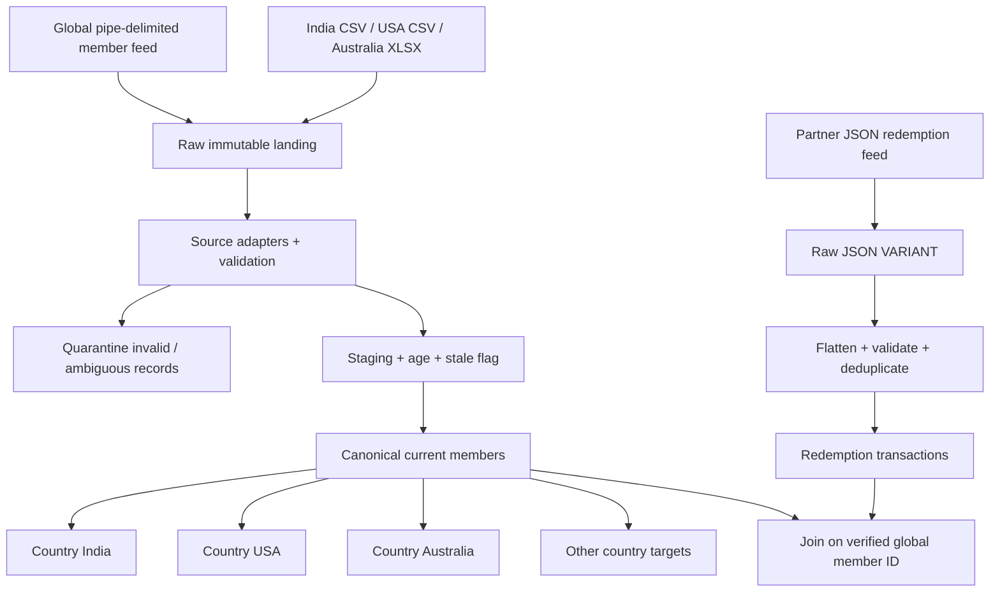

# Architecture and scaling rationale

## Data flow

## Grain and identity

- Raw member: one physical source row, including file name, feed date, namespace, row number, and payload hash.
- Staging: one validated member observation; may include multiple versions of a member over time.
- Current member: one row per **verified global identity or namespaced local identity**.
- Country target: exactly one row for each current member belonging to that country.
- Redemption: one logical transaction keyed by `(member_key, partner, txn_id)`; status may change in a later feed.

Do not join country-local `ID=1` to global `member_id=1` without an authoritative identity mapping. Global and local IDs intentionally have different prefixes. If the source confirms local IDs map to global IDs, maintain a separate audited crosswalk table with validity dates and uniqueness checks.

## Latest record wins / country movement

The sample lacks `member_updated_at`. Production should request an authoritative timestamp or version from the source. For the demo, a newer feed date wins. Same-date conflicting values are quarantined rather than arbitrarily selected. The process must handle late-arriving older feeds without overwriting newer state.

For a move `GLOBAL:223457` from USA to IND:

1. Determine the winning update and verify it is newer.
2. Begin a transaction.
3. Delete the old `country_usa` row for this member.
4. Upsert `current_members` to IND.
5. Upsert `country_india`.
6. Commit. Roll back all changes on failure.

Use idempotent upserts so retries do not create duplicates.

## How to support billions of records per day

**This is a proposed production design, not a measured benchmark.**

1. **Land data in cloud object storage** with date/hour/source partitioning and immutable file manifests. Use file checksums, ingest audit tables, and source delivery contracts. Convert large XLSX files into splittable Parquet/CSV in a controlled preprocessing step; XLSX is not suitable for distributed ingestion at scale.
2. **Parallelize extraction and loading** using Snowflake `COPY INTO`/Snowpipe, or Spark with distributed readers. Process files in bounded batches/micro-batches. Avoid collecting full datasets to a single Python process.
3. **Separate raw, standardized and curated data.** Keep raw data immutable for replay and lineage; standardize schema and dates; quarantine bad records without stopping unrelated partitions.
4. **Incremental CDC / MERGE**: only changed members are compared with canonical current state. Use streams/tasks or a controlled orchestration job and file/batch idempotency keys. Avoid daily full-table scans or rebuilding all country tables.
5. **Deterministic latest-wins** based on source update timestamp/version; use feed date only as fallback with explicit conflict handling. At large scale, detect conflicting updates by member key in distributed staging before MERGE.
6. **Physical country tables**: the assessment asks for them, so the Snowflake script demonstrates them. A single canonical table with `country_code` plus per-country secure views is often simpler, cheaper and easier to keep consistent. Choose physical tables only if required for residency, access controls, or downstream contracts; enforce cross-country consistency transactionally.
7. **Redemptions**: store JSON as VARIANT, use `LATERAL FLATTEN` to produce one row per transaction, deduplicate by `(global member, partner, txn ID)` and upsert only newer status versions. For financial reporting, count only `COMPLETED` miles and reconcile totals by partner/date.
8. **Data quality**: monitor missing/invalid keys, duplicate IDs, unexpected countries, schema drift, malformed dates, invalid miles, orphan redemptions, row-count changes, rejected percentages, and country-table reconciliation.
9. **Operational reliability**: orchestrated retries, dead-letter/quarantine, audit metadata, role-based access, PII protection, data retention, monitoring, alerting, backfill/replay procedures, and regression tests.
10. **Performance and cost**: choose warehouse size after testing representative data; benchmark ingest, dedup, MERGE, JSON flatten, and clustering choices. Consider clustering/partition pruning only where query patterns and volumes justify cost.

## Correctness guarantees and limits

- SQLite demo is ACID for country moves, but cannot demonstrate cloud-scale parallel ingestion.
- Snowflake standard-table PRIMARY KEY constraints are informational. Uniqueness requires deduplication and quality checks.
- The sample has no reliable `updated_at`; the feed-date fallback cannot perfectly order two different updates on the same day.
- A member's stale flag depends on **as-of date** even when their source record does not change. In production, recompute stale status daily or expose a computed view.
- Redemptions for an unknown global member are retained as unmatched; do not discard financial events simply because the profile arrives later.
- Sensitive member data (DOB, profiles) requires encryption, masking, least privilege, and approved retention policies.
